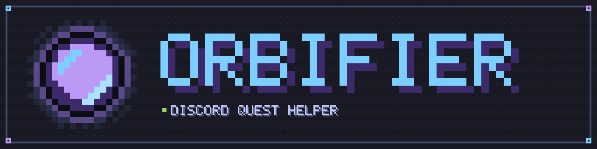
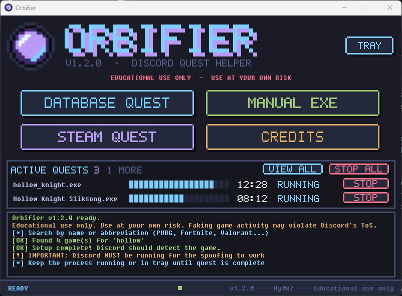
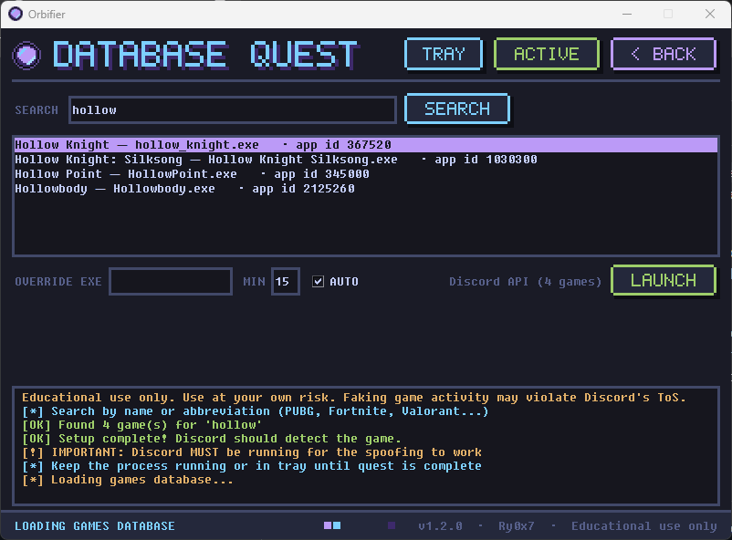
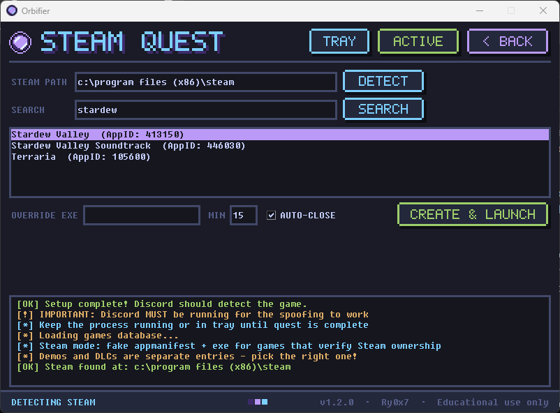
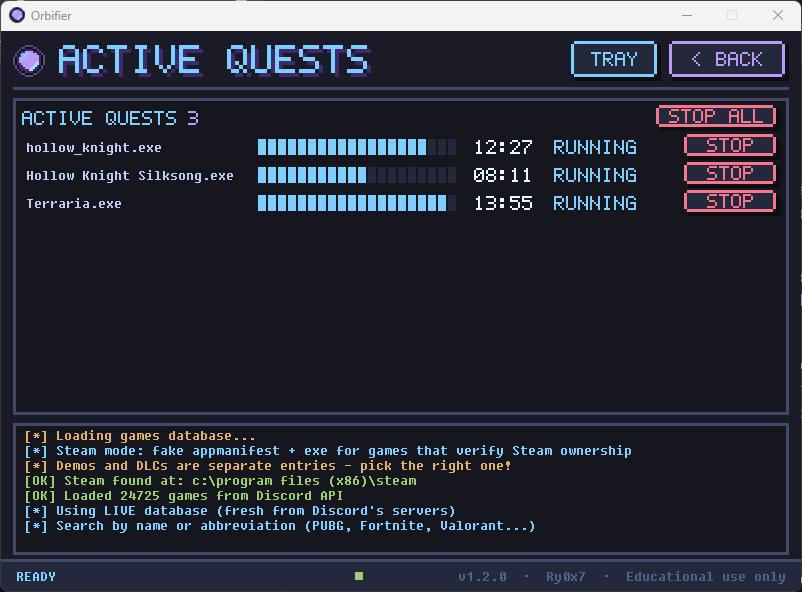

<p align="center">
  
</p>

<p align="center">
  <a href="https://github.com/Ry0x7/orbifier/releases/latest"></a>
  <a href="LICENSE"></a>
  
  <a href="https://ko-fi.com/ry0x7"></a>
</p>

> [!WARNING]
> **EDUCATIONAL USE ONLY. USE AT YOUR OWN RISK.**
> Orbifier exists to demonstrate how process-name based game detection works. Faking game activity can violate Discord's Terms of Service and individual quest rules, and may get rewards withheld or your account actioned. Steam mode writes files into your real Steam library. The author takes no responsibility for any consequences. See [Legal](#legal).

> [!NOTE]
> **Attribution & Original Source:** Orbifier is directly based on and forked from **[orbshacker](https://github.com/strykey/orbshacker)** created by **[Strykey](https://github.com/strykey)**. All credit for the original game-spoofing technique, research into Discord's detectable game registry, and initial design goes to Strykey. Orbifier extends the original concept under GPL-3.0 with a retro pixel-art interface, a regional Quest Board, multi-quest tracking, Steam integration, synchronized keep-alive timer windows with system tray support, and automatic workspace clean up.

## What it is

Discord decides which game you are playing by inspecting visible top-level windows and process names. Orb quests only need that executable name to be detected. Orbifier looks up the exact executable name Discord expects for a game, starts a lightweight keep-alive process under that name, and lists it in an ACTIVE QUESTS panel with a countdown so you can track and stop it when you are done.
It is an **educational project** based on Strykey's [orbshacker](https://github.com/strykey/orbshacker); **use it at your own risk** and read the [Legal](#legal) section before you do.

## Screens

| | |
|---|---|
|  |  |
| **Home**: the main menu, system tray button, and a live strip showing active quests. | **Database**: search Discord's official game list, customize timer duration, and toggle auto-close. |
|  |  |
| **Steam**: automated fake appmanifest and executable generation for Steam-verified quests. | **Active quests**: multi-quest tracking with live block progress bars, stop controls, and auto-cleanup. |

The **Quest Board** screen is reachable from the **QUEST BOARD** button on the home grid;
it lists active quests across regions and can launch supported desktop quests.
Screenshots may predate this addition; the home grid now has six buttons.

## Get it

- **Prebuilt:** grab `orbifier.exe` from the [Releases](https://github.com/Ry0x7/orbifier/releases)
  page and run it. Nothing to install. Windows SmartScreen may warn about an unsigned exe.
- **From source:** clone the repo and run `run.bat`. On first run it creates a `.venv` and
  installs `requirements.txt` (Python 3 required).
- **Console menu:** `run.bat --cli` (or `orbifier.exe --cli`) opens the text menu instead of
  the window.

| Flag | What happens |
|---|---|
| *(none)* | Opens the pixel-art window. |
| `--cli` | Opens the console menu (the exe attaches a console for it). |
| `--timer-mode` | Internal: runs the silent keep-alive. The renamed copies are started with it; you do not need it yourself. |

## How a quest run works

1. You pick a game on the Database screen (or type an exe name on Manual EXE), and select the desired timer duration.
2. Orbifier copies itself (the frozen exe) or `pythonw.exe` (source run) into
   the selected **OUTPUT FOLDER** under the game's executable name, e.g. `hollow_knight.exe`.
   Manual and Database screens share this folder selection; it defaults to `Desktop\Win64\`.
   Use **BROWSE** or type a directory. The CLI also prompts for an optional output folder.
3. It launches that copy with a compact keep-alive window displaying the active game title and countdown timer.
4. Discord scans running top-level windows, detects the game process name, and treats the game as actively played.
   Discord has to be running for detection to work.
5. You can keep the keep-alive window open, minimize it, or click **HIDE TO TRAY** to tuck it into the notification area (Discord continues detection while in tray).
6. ACTIVE QUESTS counts down in perfect sync with the keep-alive window. When time elapses:
   - If **AUTO-CLOSE** is on (default), the process automatically terminates and Orbifier cleans up the `.exe` and empty directories.
   - If off, STOP terminates the process and cleans up files on demand. STOP ALL stops every active quest.

The quest only progresses when the detected process maps to the quest's exact Discord
application id. Several games share a name (there are multiple "Call of Duty" entries), so
check the app id shown next to each search result and in the launch confirmation, and pick
the entry for the exact title the quest names. Search results are ranked (exact name first)
and capped at 50.

### Troubleshooting

- Do not run Orbifier as administrator. Discord, running normally, cannot see elevated
  processes, so the game never shows up. Orbifier warns on startup if it is elevated.

## Quest Board

**QUEST BOARD** is a read-only discovery screen for active Discord quests. It uses the
public, unofficial [discordquest.com](https://discordquest.com) dataset and does **not**
log in to Discord or use a token. It shows:

- quest name, game, Discord app id, reward, task type, and end time;
- a region filter with `ALL`, `GLOBAL`, and the country codes seen in the data;
- **DESKTOP ONLY** (default), which hides watch-video, console, and activity quests.

Regional variants of one campaign are grouped into a single row. The region line shows
either `GLOBAL`, a short country list, `GLOBAL EXCEPT ...`, or `N REGIONS`. Region data is
informational: Discord decides eligibility, and Orbifier does not bypass region locks.

For `PLAY ON DESKTOP` quests, **LAUNCH** resolves the Discord app id in the game database,
previews the executable, timer, auto-close setting, and output path, then reuses the same
fake-process flow as the Database screen. If the app id or executable is missing,
**FIND GAME** jumps to the Database screen with the game name filled in. Watch-video,
console, and activity quests can be inspected when **DESKTOP ONLY** is off, but cannot be
launched by Orbifier. Orbifier does not auto-claim quests.

The board is cached in memory for five minutes; **REFRESH** forces a reload. If a refresh
fails, the previous data stays on screen. Quest and region data:
[discordquest.com](https://discordquest.com) (unofficial public dataset).

## Steam quests

Some quests also check that the game looks installed through Steam. Steam mode writes two
extra things into your Steam folder:

- `steamapps\appmanifest_<appid>.acf`, a minimal manifest for the chosen app id
- a copy of the placeholder at `steamapps\common\<installdir>\<exe>`

Choose your Steam installation, another Steam library root, or its `steamapps` folder
using **STEAM PATH / BROWSE**. Enter a game name or a numeric Steam App ID in
**NAME / APP ID**, then click **SEARCH**. App IDs work without a store search.
**INSTALL FOLDER** overrides the folder name under `steamapps\common`; leave it blank
to use the detected name. **OVERRIDE EXE** accepts a relative path, including subfolders.
The resolved path is shown before files are created. Paths ending outside the selected
install folder are rejected.

**INSTALLED MANIFEST** is selected by default and writes the minimal `AppState` fields
with `StateFlags "4"`. Uncheck it for the previous staged manifest (`StateFlags "1026"`).
The CLI offers the same settings. If an executable, manifest, or install folder
already exists from a previous setup, Orbifier overwrites it cleanly without error.
You can also use the **DELETE** button (or 'd' option in the CLI) to remove the
placeholder executable, helper files, manifest, and install folder.

For the EA SPORTS FC 27 instructions:

1. Choose your Steam library or `steamapps` folder.
2. Search for App ID `4080220`.
3. Set **INSTALL FOLDER** to `EA SPORTS FC 27` (or keep the detected value).
4. Use `fc27.exe` as the executable. It is mapped automatically for this App ID;
   `..\EA SPORTS FC 27\fc27.exe` also resolves to the same destination.
5. Keep **INSTALLED MANIFEST** checked, then **CREATE & LAUNCH**.

This creates `steamapps\appmanifest_4080220.acf` and
`steamapps\common\EA SPORTS FC 27\fc27.exe` without duplicating the game folder.

Orbifier does **not** clean these up automatically. STOP removes the placeholder exe, but the
`.acf` file remains until you delete it, and Steam may show the game as installed in
the meantime. Empty game subfolders may be removed during cleanup; the selected
output folder and the library's `common` directory are preserved.

## Settings

Edit `settings.py` next to the app (source run) and restart.

| Key | Default | Meaning |
|---|---|---|
| `VERSION` | `"1.5.0"` | Version shown in the window and used by the update check. |
| `DEVELOPER` | `"Ry0x7"` | Name shown in the status bar. |
| `GITHUB_REPO_OWNER` | `"Ry0x7"` | Owner of the repo the exe checks for updates. |
| `GITHUB_REPO_NAME` | `"orbifier"` | Repo the exe checks for updates. |
| `FAKE_EXE_DIR` | `"Win64"` | Folder on the Desktop that holds the placeholder copies. |
| `SLEEP_SHORT` | `1.0` | Short pause (seconds) in the console menu. |
| `SLEEP_LONG` | `2.0` | Long pause (seconds) in the console menu. |
| `MAX_SEARCH_RESULTS` | `50` | Maximum games listed per database search. |
| `QUEST_MINUTES` | `20` | Default length of the ACTIVE QUESTS countdown per game. |
| `AUTO_CLOSE` | `True` | Automatically close the fake game process when timer completes. |
| `AUTO_CLEAN` | `True` | Automatically remove fake exe and empty directories on stop. |

## Build it yourself

- `build.bat` creates a `.venv`, installs PyInstaller and builds `dist\orbifier.exe`.
- `orbifier.spec` is the PyInstaller recipe. It must stay one-file: the exe copies itself to
  make the placeholders.
- Tests: `python -m pytest tests -q`.

## Project layout

```
orbifier.py              entry point (GUI, --cli, --timer-mode)
settings.py              user settings
orbifier.spec            PyInstaller spec
build.bat / run.bat      build the exe / run from source
requirements.txt
orbifier/
  gui.py                 pixel-art window, screens, ACTIVE QUESTS panel
  quest_board.py         public Discord quest/region dataset, grouping and filtering
  quests.py              quest bookkeeping: countdown, status, stop and cleanup
  faker.py               copies and launches the placeholder exe
  timer.py               keep-alive window with countdown and tray support
  tray.py                lightweight Windows system tray integration
  discord_db.py          Discord detectable-games list and search
  steam.py               Steam path, store search, appmanifest writer
  main.py                console menu
  ui.py                  console colours, banner, credits text
  config.py              defaults merged with settings.py
  updater.py             release update check for the exe
  net.py, errors.py      HTTP helpers, error types
  __init__.py, __main__.py
docs/                    banner, icon, screenshots
tests/                   pytest suite
.github/workflows/release.yml   builds and publishes the exe on a version tag
CONTRIBUTING.md, LICENSE
```

## Credits & Attribution

Orbifier is fundamentally based on and powered by the original research and implementation of **[orbshacker](https://github.com/strykey/orbshacker)** created by **[Strykey](https://github.com/strykey)**.

Huge credit and special thanks go to **Strykey** for pioneering the process-name spoofing technique for Discord Orb quests, mapping Discord's detectable application endpoints, and creating the original tool. Orbifier builds on Strykey's groundwork under the terms of the GNU General Public License v3.0 (GPL-3.0).

- **Original Project Repository:** [https://github.com/strykey/orbshacker](https://github.com/strykey/orbshacker)
- **Original Author:** [Strykey](https://github.com/strykey)

The **Quest Board** uses the public, unofficial [discordquest.com](https://discordquest.com)
dataset for quest and region information. Region availability is informational; Discord
decides final eligibility.

## Support

Orbifier is free. If it saved you some time and you want to say thanks, you can leave a tip on
[Ko-fi](https://ko-fi.com/ry0x7).

<a href="https://ko-fi.com/ry0x7"></a>

## Legal

**This software is for educational use only. Use it at your own risk.**

Orbifier is provided for educational purposes, to show how process-name based game
detection can be fooled. Faking game activity may break Discord's Terms of Service and
the rules of individual quests, and can get rewards withheld or an account actioned.
You are responsible for how you use it. The author is not affiliated with Discord, Valve
or any game publisher, and the software comes with no warranty.
Steam mode leaves an appmanifest file and a placeholder folder in your Steam library, which
you must remove yourself.

## License

Copyright (C) 2026 Strykey
Copyright (C) 2026 Ry0x7

This program is free software: you can redistribute it and/or modify it under the terms
of the GNU General Public License as published by the Free Software Foundation, either
version 3 of the License, or (at your option) any later version. It is distributed
WITHOUT ANY WARRANTY. See [LICENSE](LICENSE) for the full text.
